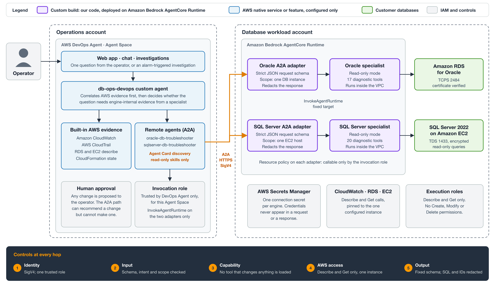
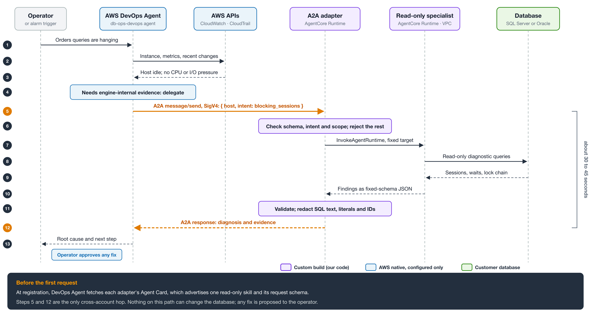
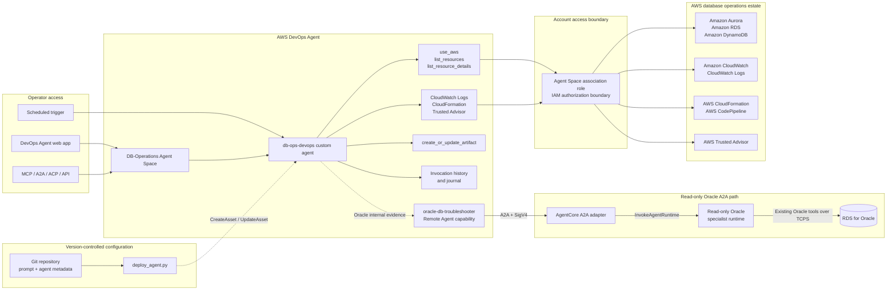

# Delegate database diagnostics from AWS DevOps Agent to AgentCore specialists over A2A

> This is sample code, for non-production usage. You should work with your
> security and legal teams to meet your organizational security, regulatory and
> compliance requirements before deployment.

This sample extends **AWS DevOps Agent** with engine-internal database
diagnostics. DevOps Agent sees AWS-level signals such as CloudWatch metrics,
CloudTrail events and RDS or EC2 configuration, but not sessions, locks or wait
events inside the database engine. The sample adds two read-only remote agents
that DevOps Agent calls over the A2A protocol:

- `oracle-db-troubleshooter` for **Amazon RDS for Oracle**
- `sqlserver-db-troubleshooter` for **SQL Server 2022 on Amazon EC2**

Each remote agent is an A2A adapter on Amazon Bedrock AgentCore Runtime. The
adapter validates a structured request, calls one read-only database specialist
from [sample-ai-db-ops](https://github.com/aws-samples/sample-ai-db-ops), and
returns redacted, fixed-schema findings. The A2A path can recommend a change but
cannot make one.

The repository also contains `db-ops-devops`, a DevOps Agent custom agent that
assesses an Amazon RDS, Amazon Aurora and Amazon DynamoDB fleet from AWS
evidence and decides when to delegate to a specialist.

## Architecture



Purple components are the custom code in this repository and in
sample-ai-db-ops. Blue components are AWS DevOps Agent features that are
configured, not built. The only cross-account hop is the SigV4-signed A2A call
from the operations account to the adapters.



The Mermaid view below documents the custom agent and its AWS evidence paths.



### How requests flow

1. An operator, integration, or scheduled trigger starts a request in the Agent
   Space. Chat dispatches `db-ops-devops` as an asynchronous background task.
2. The custom agent follows `SYSTEM_PROMPT.md`, selects its assigned AWS tools,
   and records progress and the final assessment in invocation history.
3. AWS API calls use the Agent Space monitor association role. Its IAM policy and
   the DevOps Agent action model define the AWS authorization boundary.
4. The agent first correlates database configuration and status with metrics,
   logs, stack state, pipeline state, and advisory findings.
5. When an RDS Oracle question requires engine-internal evidence, the custom
   agent delegates to `oracle-db-troubleshooter`. The SigV4-authenticated A2A
   adapter calls one configured read-only Oracle specialist runtime, whose tools
   connect to RDS for Oracle inside the VPC. The adapter never forwards approval
   decisions, so this path cannot complete a mutating Oracle operation.
6. `deploy_agent.py` publishes the custom-agent prompt and metadata. The separate
   A2A runtime and remote-provider registration use the guarded artifacts under
   `agentcore/`, `infra/`, and `configure_remote_agent.py`.

## Contents

| File | Purpose |
|---|---|
| `SYSTEM_PROMPT.md` | The agent's system prompt. This is the substance of the agent. |
| `agent.json` | Name, status, and the tool and skill assignments. |
| `deploy_agent.py` | Creates or updates the agent in an Agent Space, idempotently. |
| `invoke_agent.py` | Dispatches the custom agent from the command line. |
| `agentcore/oracle_a2a/` | Read-only AgentCore A2A adapter for the AI-DB-OPS Oracle specialist. |
| `agentcore/sqlserver_a2a/` | Read-only AgentCore A2A adapter for the AI-DB-OPS SQL Server on EC2 specialist. |
| `configure_remote_agent.py` | Plans or applies the SigV4 remote-agent registration and Agent Space association, per engine (`--engine oracle` or `--engine sqlserver`). |
| `remote_agents/` | One registration definition per engine. |
| `infra/oracle-a2a-roles.yaml`, `infra/sqlserver-a2a-roles.yaml` | Least-privilege runtime and DevOps Agent invocation roles, one stack per engine. |
| `tools/a2a_client.py` | SigV4 A2A client: fetches an adapter's Agent Card and sends a diagnostic request, exactly as DevOps Agent does. |
| `infra/ops-account-agent-space-roles.yaml` | Operations-account roles for a two-account setup: Agent Space monitor role, web app role, and the remote-agent invocation role. |
| `infra/workload-account-source-role.yaml` | Workload-account role that lets the Agent Space read AWS evidence from the account that hosts the databases. |
| `demo/` | Demo runbook, preflight check, and a script that stages a real SQL Server blocking incident on a demo host. |
| [`docs/oracle-a2a-integration.md`](docs/oracle-a2a-integration.md) | Architecture, controls, step-by-step deployment, and the per-engine extension pattern. |
| [`docs/diagrams/`](docs/diagrams/) | `a2a-architecture.svg` (two-account architecture) and `a2a-sequence.svg` (one delegated request), with PNG renders. |

## Prerequisites

- An AWS DevOps Agent Agent Space.
- The read-only specialists from
  [sample-ai-db-ops](https://github.com/aws-samples/sample-ai-db-ops), deployed
  to AgentCore Runtime in the account that hosts the databases:
  `dbops_oracle_readonly` and `dbops_sqlserver_readonly`. They run with
  `DBOPS_READ_ONLY_MODE=true`, so the tools that change anything are not
  registered. Each adapter refuses any downstream runtime whose name does not
  match `dbops_<engine>_readonly-*`.
- An Amazon RDS for Oracle instance reachable over TCPS, a SQL Server 2022 host
  on Amazon EC2, or both, each with a connection secret in AWS Secrets Manager.
- Python 3.12 and the AWS CLI v2.

## Deploying

The agent is stored as an asset of type `custom_agent` in your Agent Space: the
system prompt is a file in the asset, and the tool assignments live in the asset
metadata.

```bash
python deploy_agent.py \
  --agent-space-id <your-agent-space-id> \
  --region us-east-1 \
  --dry-run

# then, to apply
python deploy_agent.py --agent-space-id <your-agent-space-id> --region us-east-1
```

Re-running updates the existing agent in place and bumps its version rather than
creating a duplicate.

You can also create it by hand: in the web app choose **Agents → Create agent →
Form**, use `db-ops-devops` as the name, and paste the contents of
`SYSTEM_PROMPT.md` into the System prompt field. Tools are then added through
Chat, for example *"Add the use_aws and query_cloudwatch_logs tools to
db-ops-devops"*.

Note that the user guide states tools can only be assigned through Chat. That is
not true of the API: `UpdateAsset` accepts a `tools` list in metadata, which is
what `deploy_agent.py` uses.

## Testing

### Web app

```
https://<agent-space-id>.aidevops.global.app.aws
```

Go to **Agents → db-ops-devops** to see the system prompt, tools, and a **History**
tab listing every invocation. Chat is on the main page.

### From the command line

```bash
python invoke_agent.py \
  --agent-space-id <your-agent-space-id> \
  --prompt "Inventory the RDS, Aurora, and DynamoDB fleet and report alarms in ALARM state."
```

### Invocation is asynchronous

This matters and is easy to get wrong. Asking Chat to run the custom agent
*dispatches* it and returns immediately. The prose that streams back is from the
built-in chat agent, not from `db-ops-devops`. The custom agent runs as a
background task and its answer never appears in the chat stream.

The reply contains a marker like:

```
[[custom_agent:ki-987080fc-...:f8512a58-...:db-ops-devops]]
```

The second UUID is the **taskId**, not the execution ID. To read the custom
agent's own output:

```python
task = client.get_backlog_task(agentSpaceId=SPACE, taskId=TASK_ID)["task"]
# task["status"] -> COMPLETED
records = client.list_journal_records(
    agentSpaceId=SPACE, executionId=task["executionId"]
)["records"]
# newest record by createdAt holds the final assistant message
```

API shape notes, since several differ from what the names suggest:

- `GetBacklogTask` returns `{"task": ...}`, not `{"backlogTask": ...}`.
- `ListBacklogTasks` and `ListJournalRecords` take `limit`, not `maxResults`.
- `SendMessage` returns `{"events": ...}`; text arrives as
  `events[].contentBlockDelta.delta.textDelta.text`.
- `ListExecutions` requires a `taskId`.

Or just use the **History** tab, which renders the same thing.

## Tools

| Tool | Used for |
|---|---|
| `use_aws` | RDS, Aurora, DynamoDB, CloudWatch, CloudFormation, and CodePipeline API calls |
| `list_resources`, `list_resource_details` | Inventory, and a fallback when a describe call is filtered |
| `query_cloudwatch_logs` | Log inspection |
| `get_account_cloudformation_stacks` | Stack state when correlating an incident with a deployment |
| `trusted_advisor_list_recommendations` | Advisory findings |
| `create_or_update_artifact` | Persisting a review report |

Tools are deliberately limited to what the prompt actually instructs the agent to
use. Adding more widens what the agent can reach without improving its answers.

## Required permissions

The Agent Space association role needs read access for the services the prompt
uses. At minimum:

- `rds:DescribeDBClusters`, `rds:DescribeDBInstances`, `rds:DescribeDBParameterGroups`, `rds:ListTagsForResource`
- `dynamodb:ListTables`, `dynamodb:DescribeTable`, `dynamodb:DescribeTimeToLive`, `dynamodb:DescribeContinuousBackups`
- `cloudwatch:DescribeAlarms`, `cloudwatch:GetMetricStatistics`, `cloudwatch:GetMetricData`
- `cloudformation:DescribeStacks`, `cloudformation:DescribeStackEvents`
- `codepipeline:GetPipelineState`, `codepipeline:ListPipelineExecutions`
- `logs:StartQuery`, `logs:GetQueryResults`, `logs:DescribeLogGroups`

All read-only. The prompt forbids mutating and destructive operations, so no write
permissions are required.

## A note on guardrails

In testing, `rds describe-db-clusters` and `rds describe-db-instances` were
intermittently blocked with *"Content blocked by guardrail"*. This is a platform
content filter applied to the tool result, not an IAM denial — the same calls
succeed from the AWS CLI with the same role.

The prompt handles this: it instructs the agent to retry with a narrower
`jmespath_filter`, then to fall back to `list_resources`, and only then to report
the data point as unavailable while naming what it tried. In testing, the narrower
retry succeeded and the fleet data was recovered.

## Safety model, stated plainly

The current Agent Space has a monitor association and no elevated role, so AWS
resource mutations are unavailable. AWS DevOps Agent directed actions are a
separate opt-in path with a dedicated elevated role, tool classification,
per-action approval in chat, scoped credentials, and CloudTrail attribution.

The Oracle A2A adapter adds another read-only boundary: it never accepts or
forwards approval decisions. If the existing Oracle specialist proposes a Tier-3
operation, the adapter reports that the operation was blocked and does not resume
it. The production target should also use a direct read-only Oracle principal.

## Verified behavior

Run against an Agent Space with a single AWS account association. The agent
searched beyond the association's home region on its own initiative and reported
which regions it covered.

Inventory returned 4 Aurora clusters (3 PostgreSQL, 1 MySQL), 3 standalone RDS
instances (2 PostgreSQL, 1 Oracle EE), 3 DocumentDB clusters, 1 Neptune cluster,
and 8 DynamoDB tables. No CloudWatch alarms were in `ALARM` state.

Beyond counting, it reported engine version, Multi-AZ, encryption-at-rest, backup
retention, and deletion protection per resource, then classified findings by
severity. It flagged `database-1` in `us-west-2` as `storage-full`, which was
confirmed independently: the instance sits at 1000 GB allocated with
`MaxAllocatedStorage` also 1000 GB, so storage autoscaling has reached its
ceiling and writes are blocked. It also noted that no alarm was firing for this
condition, and called that a monitoring gap.

Guardrail-blocked RDS calls were recovered through the documented fallback, and
the agent reported which fallback it used.

Worth knowing for a demo: the built-in chat agent, asked the same question,
returned only counts. The depth above came from the custom agent's own run, which
is visible in the History tab rather than the chat stream.

## Engine coverage

Each engine is a separate remote agent with its own Agent Card, AgentCore
runtime ARN, execution role, database secret, and tool catalog. Adding an engine
registers a new remote agent; it does not modify an existing specialist.

| Engine | Target | Specialist runtime | Delegated scope |
|--------|--------|--------------------|-----------------|
| Oracle | RDS for Oracle, managed | `dbops_oracle_readonly` | Sessions, waits, blocking, tablespaces, redo, ASH top SQL |
| SQL Server | SQL Server 2022 on EC2, self-managed | `dbops_sqlserver_readonly` | Requests, wait stats, blocking, tempdb, file IO, memory clerks, missing indexes |

The two differ in where infrastructure facts come from, because only one is
managed by RDS. The Oracle path reads `rds:DescribeDBInstances` and the
`AWS/RDS` CloudWatch namespace. The SQL Server path reads
`ec2:DescribeInstances` and the `AWS/EC2` namespace, which carries no memory or
free-storage metrics, so memory is read from SQL Server's own DMVs instead. SQL
Server also has no managed snapshot API, so its backup tool issues a native
copy-only `BACKUP DATABASE` and reads history from `msdb`.

## Limitations

- Delegated troubleshooting is read-only. Each adapter can only target a
  `*_readonly` specialist runtime, which AI-DB-OPS deploys with
  `DBOPS_READ_ONLY_MODE=true`: the mutating tools are not registered, payload
  approvals are ignored, and the execution role grants only Describe/Get
  actions. The A2A path can recommend a change but cannot make one.
- The adapters add a runtime hop and depend on the `dbops_oracle_readonly` and
  `dbops_sqlserver_readonly` HTTP runtimes. The interactive `dbops_oracle` and
  `dbops_sqlserver` runtimes used by the AI-DB-OPS UI are separate and are not
  reachable from this path. The production optimization is a direct A2A
  specialist per engine using a dedicated read-only database principal.
- Coverage is limited to accounts associated with the Agent Space and databases
  configured behind a remote specialist.
- AWS DevOps Agent imports agent prompts only from GitHub. Use
  `deploy_agent.py` to publish the prompt from any other source.
- SQL Server's driver, `pymssql`, takes its TLS configuration from
  `freetds.conf` and exposes no per-connection CA bundle, so that connection is
  encrypted but the certificate is not verified. TDS still encrypts the login
  packet, so credentials do not cross the network in cleartext. Enable
  `ForceEncryption` with a trusted certificate to make session encryption
  guaranteed rather than negotiated.

## Two-account deployment

The architecture above keeps the Agent Space in an operations account and the
adapters, specialists and databases in a workload account.

1. In the workload account, deploy the specialists, then
   `infra/oracle-a2a-roles.yaml`, `infra/sqlserver-a2a-roles.yaml` and both
   adapters, as described in
   [docs/oracle-a2a-integration.md](docs/oracle-a2a-integration.md).
2. In the operations account, deploy `infra/ops-account-agent-space-roles.yaml`
   with the Agent Space ID and both adapter runtime ARNs.
3. In the workload account, deploy `infra/workload-account-source-role.yaml` and
   associate the workload account with the Agent Space as a source account, so
   DevOps Agent can read CloudWatch, CloudTrail, RDS and EC2 evidence there.
4. In the workload account, attach a resource policy to each adapter that allows
   only the invocation role from step 2. Attach it to the runtime ARN and to its
   `DEFAULT` endpoint ARN. A statement can name only one resource ARN, so use one
   policy per ARN:

   ```bash
   for arn in "$SQLSERVER_A2A_RUNTIME_ARN" "$SQLSERVER_A2A_RUNTIME_ARN/runtime-endpoint/DEFAULT"; do
     aws bedrock-agentcore-control put-resource-policy --resource-arn "$arn" \
       --policy "$(jq -nc --arg role "$INVOCATION_ROLE_ARN" --arg arn "$arn" '{
         Version: "2012-10-17",
         Statement: [{
           Sid: "AllowAgentSpaceInvocationRoleOnly",
           Effect: "Allow",
           Principal: {AWS: $role},
           Action: ["bedrock-agentcore:InvokeAgentRuntime", "bedrock-agentcore:GetAgentCard"],
           Resource: $arn
         }]}')"
   done
   ```

   Repeat for `$ORACLE_A2A_RUNTIME_ARN`.
5. In the operations account, register each remote agent with
   `configure_remote_agent.py --engine <oracle|sqlserver> --allow-cross-account`,
   review the printed plan, then run it again with `--apply`.

Remote-agent registration (`RegisterService` for `remoteagentsigv4`) may not be
available in every account. Where it is denied, the adapters still accept
direct signed A2A calls, so you can verify a deployment with
`tools/a2a_client.py`.

## Calling a specialist directly

`tools/a2a_client.py` makes the same two calls DevOps Agent makes after
registration: it fetches the adapter's Agent Card, then sends a signed A2A
`message/send` whose text part is the structured diagnostic request. Use it to
verify a deployment, or to demonstrate a specialist where registration is not
available.

```bash
# Discover what the specialist offers.
.venv/bin/python tools/a2a_client.py card --profile <profile> \
  --runtime-arn <sqlserver_db_troubleshooter_a2a runtime ARN>

# SQL Server on EC2: requests are scoped by EC2 instance ID.
.venv/bin/python tools/a2a_client.py ask --profile <profile> \
  --runtime-arn <sqlserver_db_troubleshooter_a2a runtime ARN> \
  --request '{"ec2_instance_id":"i-0123456789abcdef0","region":"us-east-1","diagnostic_intent":"tempdb_usage","time_range_minutes":30}'

# RDS for Oracle: requests are scoped by DB instance identifier.
.venv/bin/python tools/a2a_client.py ask --profile <profile> \
  --runtime-arn <oracle_db_troubleshooter_a2a runtime ARN> \
  --request '{"db_instance_identifier":"<db-id>","region":"us-east-1","diagnostic_intent":"blocking_sessions","time_range_minutes":30}'
```

SQL Server intents: `active_sessions`, `wait_events`, `blocking_sessions`,
`top_sql`, `sql_plan`, `index_usage`, `missing_indexes`, `tempdb_usage`,
`file_io`, `memory_pressure`, `backup_status`, `instance_health`,
`general_health`. Permitted `aws_evidence` keys come from the `AWS/EC2`
namespace: `CPUUtilization`, `CPUCreditBalance`, `NetworkIn`, `NetworkOut`,
`EBSReadOps`, `EBSWriteOps`, `EBSIOBalance%`, `StatusCheckFailed`.

Prefer a targeted intent over `general_health`. Targeted intents complete in
roughly 35 to 45 seconds; `general_health` runs every check and can exceed the
45-second downstream timeout, which is set below the DevOps Agent 60-second idle
limit on purpose.

Each adapter rejects, without contacting the database, a request for a host it
is not mapped to, a request containing a connection string or credential, an
unknown intent such as `execute_sql`, and an evidence metric from another
engine's namespace.

## Security

See [CONTRIBUTING](CONTRIBUTING.md#security-issue-notifications) and
[SECURITY.md](SECURITY.md) for more information.

## License

This library is licensed under the MIT-0 License. See the [LICENSE](LICENSE) file.
