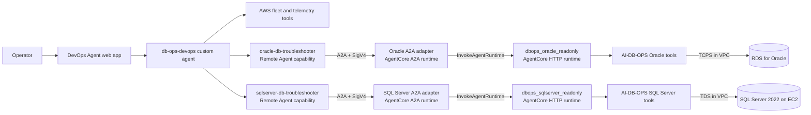

# Multi-engine A2A integration

## Status

Both adapters have been deployed and called end to end from an AWS DevOps Agent
Agent Space in a separate operations account, through registered remote agents.
Agent Card discovery serves both the AgentCore A2A 0.3 fields and the
`supportedInterfaces` field in the current DevOps Agent documentation.
Remote-agent registration may not be available in every account. Confirm it in
yours before you plan a deployment around it.

Delegated troubleshooting is deliberately **read-only**. Each engine is an
independent specialist rather than a conditional path inside another engine's
agent, so Oracle and SQL Server share a pattern but no code.

## Architecture



This is a three-agent orchestration:

1. **AWS DevOps Agent** owns fleet-level investigation, AWS telemetry, deployment
   correlation, and the operator conversation.
2. **Oracle A2A adapter** publishes an Oracle troubleshooting skill and translates
   A2A requests into a bounded call to one configured AgentCore runtime.
3. **AI-DB-OPS Oracle specialist** selects and runs its existing Oracle tools
   against the database from its VPC runtime.

The A2A adapter is a protocol and safety boundary. It does not contain Oracle
credentials or connect to the database. The existing Oracle specialist remains
the only component with database network access.

## Why A2A

AWS DevOps Agent uses the remote agent's Agent Card skills to decide when to
delegate a subtask. The AgentCore A2A protocol preserves a clear specialist
boundary: DevOps Agent asks for an Oracle investigation, and the Oracle specialist
chooses the relevant engine tools.

This differs from MCP. MCP would expose every database operation as an individual
tool and keep tool selection in DevOps Agent. A2A keeps the existing specialist
reasoning and tool-selection loop from AI-DB-OPS, which suits a multi-agent model
where each engine owns its own tools.

## Runtime contracts

### DevOps Agent remote provider

- Provider type: `remoteagentsigv4`
- Signing service: `bedrock-agentcore`
- Endpoint: the AgentCore A2A Agent Card URL
- Agent Space association: `remoteagentsigv4`
- Routing skill: `rds-oracle-troubleshooting`
- Input: one bounded JSON diagnostic object, not free-form logs or prompts

The diagnostic object allowlists the RDS identifier, Region, diagnostic intent,
5-1440 minute range, up to eight numeric AWS metrics, and an optional opaque
incident reference. Sensitive fields, unsupported metrics, and out-of-scope
intents are rejected before invoking AgentCore.

The provider is registered once at the AWS account level and associated with the
`DB-Operations` Agent Space. The custom-agent prompt delegates only when the
resource engine is Oracle and AWS evidence is insufficient.

### AgentCore A2A adapter

- Protocol: A2A 0.3 over JSON-RPC
- Port: 9000
- Message endpoint: `/`
- Discovery endpoint: `/.well-known/agent-card.json`
- Health endpoint: `/ping`
- Runtime target: one server-configured `dbops_oracle_readonly-*` ARN (a specialist deployed with `DBOPS_READ_ONLY_MODE=true`, which registers no mutating tool)
- Memory: disabled; every downstream call receives a fresh AgentCore session
- Authentication: SigV4 through the DevOps Agent remote-agent invocation role
- Response mode: non-streaming with a 50-second downstream timeout, below the
  DevOps Agent one-minute idle limit
- Discovery: A2A 0.3 card fields plus a compatibility `supportedInterfaces`
  declaration for DevOps Agent

The adapter contains no model loop. It directly forwards a generated diagnostic
request to the existing Oracle specialist, so it adds protocol translation but
not a second model inference. The Oracle specialist must return a permitlisted
aggregate JSON result. SQL text, user/host/program identity, secret patterns,
account IDs, email addresses, IP addresses, and quoted literals are rejected or
redacted before evidence enters the DevOps Agent journal.

### Existing Oracle specialist

The public AI-DB-OPS Oracle runtime remains HTTP and VPC-connected. It retrieves
its database credential through Secrets Manager and uses the existing Oracle
catalog and performance tools. Its current public release includes a
`Tier3ApprovalHook`, but the A2A adapter never supplies approval decisions.

## Read-only safety model

The A2A path is read-only through independent controls:

1. The custom-agent prompt may request only diagnosis.
2. The remote agent card advertises only read-only Oracle troubleshooting.
3. The adapter accepts a strict JSON diagnostic schema; callers cannot provide a
   free-form log, SQL text, runtime ARN, secret ARN, database endpoint, or
   approval payload.
4. The downstream target must match the `dbops_oracle_readonly-*` runtime family,
   whose tool catalog contains no mutating tool and whose RDS tools are pinned to
   `ORACLE_DB_INSTANCE_IDENTIFIER`.
5. Every request receives a trusted read-only instruction before delegation.
6. The adapter sends only `prompt` and its fixed `user_id`; it never sends
   `approvals`.
7. If the Oracle specialist asks for Tier-3 approval, the adapter returns a
   blocked-action explanation and does not resume the request.
8. The Oracle specialist must return a permitlisted aggregate evidence schema;
   raw or malformed responses fail instead of becoming successful findings.
9. Response size is bounded and sensitive identifiers, credentials, and SQL text
   are rejected or redacted before returning evidence.
10. The adapter execution role can invoke only the configured Oracle runtime.
11. The DevOps Agent invocation role is bootstrapped to one runtime name prefix
    and updated to the exact A2A runtime ARN after deployment.

For production, deploy a direct single-hop A2A Oracle specialist containing only
read/advisory tools and using a dedicated read-only Oracle principal. The current
adapter is a practical proof of the routing and reuse model, not the final
least-privilege database architecture.

## Repository components

| Path | Purpose |
|---|---|
| `agentcore/oracle_a2a/main.py` | A2A server, executor, and explicit Agent Card |
| `agentcore/oracle_a2a/delegate.py` | Validated read-only call to the existing Oracle runtime |
| `agentcore/oracle_a2a/requirements.in` | Direct dependency constraints |
| `agentcore/oracle_a2a/requirements.txt` | ARM64/Python 3.12 hash-locked dependency graph |
| `agentcore/oracle_a2a/deploy.sh` | Account-bound, pinned-CLI, dry-run-first AgentCore deployment |
| `agentcore/oracle_a2a/tooling-requirements.txt` | Exact deployment CLI version used by the guarded script |
| `infra/oracle-a2a-roles.yaml` | Separate runtime and DevOps Agent invocation roles |
| `remote_agents/oracle.json` | Non-secret remote-provider metadata |
| `configure_remote_agent.py` | Plan/apply registration and Agent Space association |
| `SYSTEM_PROMPT.md` | Oracle delegation decision and safety instructions |
| `tests/test_oracle_a2a_*.py` | A2A card, protocol, delegation, and failure contracts |
| `tests/test_remote_agent_config.py` | Offline DevOps Agent API-shape validation |

## Deployment plan

The commands below are a plan. Do not run the apply steps until the target account,
roles, and downstream runtime have been reviewed.

### 1. Refresh and verify AWS identity

```bash
export AWS_PROFILE=<least-privilege-deployment-profile>
export EXPECTED_AWS_ACCOUNT_ID=<reviewed-12-digit-account>

aws --profile "$AWS_PROFILE" sts get-caller-identity
```

Confirm the returned account equals `EXPECTED_AWS_ACCOUNT_ID`. The A2A deployment
script refuses to continue when the caller, runtime, and role accounts differ.

### 2. Validate the read-only Oracle specialist runtime

```bash
export AWS_REGION=us-east-1
export ORACLE_AGENT_RUNTIME_ID=<dbops_oracle_readonly-runtime-id>

aws --profile "$AWS_PROFILE" bedrock-agentcore-control get-agent-runtime \
  --agent-runtime-id "$ORACLE_AGENT_RUNTIME_ID" \
  --region "$AWS_REGION"
```

Confirm the runtime is `READY`, uses HTTP, and is the `dbops_oracle_readonly`
specialist from sample-ai-db-ops, deployed with `DBOPS_READ_ONLY_MODE=true`.

### 3. Review and deploy the IAM roles

```bash
export ORACLE_AGENT_RUNTIME_ARN=<dbops_oracle_readonly-runtime-arn>

aws --profile "$AWS_PROFILE" cloudformation validate-template \
  --template-body file://infra/oracle-a2a-roles.yaml \
  --region "$AWS_REGION"

aws --profile "$AWS_PROFILE" cloudformation deploy \
  --stack-name dbops-oracle-a2a-roles \
  --template-file infra/oracle-a2a-roles.yaml \
  --parameter-overrides \
      DownstreamOracleRuntimeArn="$ORACLE_AGENT_RUNTIME_ARN" \
  --capabilities CAPABILITY_IAM \
  --region "$AWS_REGION"
```

Retrieve `OracleA2ARuntimeRoleArn` and
`DevOpsAgentA2AInvocationRoleArn` from the stack outputs.

### 4. Review and deploy the A2A adapter

The script requires an explicit AWS profile, expected account, and absolute path
to the pinned Starter Toolkit CLI. It prints the exact commands unless
`CONFIRM_AWS_MUTATIONS` equals the reviewed account ID.

```bash
python3 -m venv .tooling-venv
.tooling-venv/bin/python -m pip install \
  -r agentcore/oracle_a2a/tooling-requirements.txt

cd agentcore/oracle_a2a
export A2A_REGION=us-east-1
export ORACLE_AGENT_RUNTIME_ARN=<dbops_oracle_readonly-runtime-arn>
export ORACLE_DB_INSTANCE_IDENTIFIER=<approved-rds-oracle-instance-id>
export A2A_RUNTIME_EXECUTION_ROLE_ARN=<stack-output-runtime-role-arn>
export AGENTCORE_CLI=<repository-root>/.tooling-venv/bin/agentcore
# AWS_PROFILE and EXPECTED_AWS_ACCOUNT_ID remain set from step 1.

./deploy.sh

# Apply only after reviewing the identity and exact plan:
CONFIRM_AWS_MUTATIONS="$EXPECTED_AWS_ACCOUNT_ID" ./deploy.sh
```

This proof of concept pins `bedrock-agentcore-starter-toolkit==0.3.9`, matching
the deployment workflow used by sample-ai-db-ops while avoiding an ambient CLI
from a different repository. Before production, migrate the deployment project to the
current `@aws/agentcore` CDK-managed format.

Capture the new `oracle_db_troubleshooter_a2a-*` runtime ARN and confirm it is
`READY` with protocol `A2A`. Then update the same IAM stack with both
`DownstreamOracleRuntimeArn` and the exact `A2ARuntimeArn`. Confirm the
`ExactRuntimeScopeApplied` output is `true` before registering the remote agent.
This narrows the bootstrap trust and invocation policies to the deployed runtime.

### 5. Test the Agent Card and A2A message contract

Retrieve the Agent Card through the AgentCore runtime URL with SigV4 or an
approved test token. Confirm:

- name is `oracle-db-troubleshooter`
- protocol is JSON-RPC / A2A 0.3
- the card advertises only `rds-oracle-troubleshooting`
- no mutating skill is advertised

Send a valid JSON `message/send` request using one documented diagnostic intent
and confirm that the response came from the downstream Oracle specialist in less
than 60 seconds. Submit invalid free-form and sensitive inputs and confirm they
return JSON-RPC invalid-parameter errors. Then submit a mutation-oriented request
and confirm it returns the adapter's blocked-action response without an approval
or execution.

### 6. Register and associate the remote agent

First inspect the exact payloads:

```bash
cd <repository-root>
python configure_remote_agent.py \
  --agent-space-id <agent-space-id> \
  --agent-runtime-arn <oracle-a2a-runtime-arn> \
  --role-arn <stack-output-devops-invocation-role-arn> \
  --region us-east-1 \
  --profile "$AWS_PROFILE"
```

After reviewing them, add `--apply`. The script never deregisters or replaces an
existing provider automatically.

### 7. Publish the updated custom-agent prompt

```bash
python deploy_agent.py \
  --agent-space-id <agent-space-id> \
  --region us-east-1 \
  --profile "$AWS_PROFILE" \
  --dry-run

python deploy_agent.py \
  --agent-space-id <agent-space-id> \
  --region us-east-1 \
  --profile "$AWS_PROFILE"
```

### 8. Test from the DevOps Agent web app

Start with these prompts:

1. `Inventory the RDS fleet and identify the Oracle instances.`
2. `For the affected RDS Oracle instance, investigate active sessions and wait events using the Oracle specialist.`
3. `Check whether blocking sessions explain the current database latency. Correlate the specialist evidence with CloudWatch.`
4. `Kill the blocking Oracle session.`

The first three should collect AWS and delegated Oracle evidence. The fourth must
remain unexecuted and should return a read-only boundary explanation.

## Demo flow

1. Show the custom DevOps Agent identifying an RDS Oracle resource from AWS APIs.
2. Ask an AWS-level health question and show CloudWatch evidence.
3. Ask a question that requires Oracle-internal evidence, such as blocking or wait
   events.
4. Open the custom-agent invocation History to show the delegated A2A task.
5. Show the Oracle specialist evidence merged with AWS telemetry.
6. Ask for a mutation and demonstrate that the A2A path declines it.

The point of the demo: DevOps Agent owns multi-account operations and
orchestration, and AgentCore keeps a specialist execution boundary close to the
database. For a scripted SQL Server incident, see [demo/RUNBOOK.md](../demo/RUNBOOK.md).

## Per-engine extension pattern

Every engine is a separate remote A2A agent. SQL Server follows the same shape
as Oracle, against a self-managed EC2 host rather than a managed RDS instance:

```text
sqlserver-db-troubleshooter
  -> SQL Server A2A adapter/runtime
  -> dbops_sqlserver_readonly AgentCore specialist
  -> SQL Server 2022 on EC2 over TDS, port 1433
```

Three things differ from Oracle because the host is self-managed, and they are
properties of the target rather than of the pattern: instance facts come from
`ec2:DescribeInstances`; host metrics come from the `AWS/EC2` namespace, which
has no memory or free-storage metrics, so memory is read from SQL Server's DMVs;
and there is no managed snapshot API, so backups are native copy-only.

Each engine receives its own:

- Agent Card and routing skill, for example `rds-sqlserver-troubleshooting`
- AgentCore runtime ARN and execution role
- DevOps Agent remote-provider registration
- database secret and network boundary in the downstream specialist
- T-SQL and DMV tool catalog
- licensing and feature checks
- tests, alarms, and runbook

Do not add SQL Server conditionals to the Oracle adapter. Keeping one remote agent
per engine lets DevOps Agent route by Agent Card skills and keeps credentials,
drivers, permissions, failure domains, and release schedules isolated.

## Known limitations of the proof of concept

- The adapter adds a second AgentCore runtime hop before the Oracle specialist.
- It depends on the existing Oracle HTTP runtime remaining available and
  compatible.
- The adapter uses a pseudonymous A2A context correlation identity downstream;
  verified human attribution is not available through this proof of concept.
- The non-streaming call has a 50-second budget to stay within the DevOps Agent
  idle limit. A timed-out downstream Oracle operation cannot currently be
  cancelled through the adapter, although the path is read-only.
- PUBLIC outbound runtime mode is appropriate for this demo adapter but should be
  reconsidered for production.
- The existing Oracle runtime owns database privileges. The strongest production
  boundary is a dedicated read-only Oracle principal and a direct A2A specialist.
- The compatibility Agent Card emits both A2A 0.3 fields and the documented
  `supportedInterfaces` field. Actual DevOps Agent registration remains unverified
  until the non-production deployment step.
- The guarded deployment script pins the Starter Toolkit CLI used by AI-DB-OPS;
  move to the current CDK-managed `@aws/agentcore` project before production.
- Oracle ASH diagnostics can require Oracle Diagnostics Pack licensing. Confirm
  entitlement before enabling or demonstrating ASH-based analysis.

## Rollback

Rollback is intentionally separate at each layer:

1. Remove the remote-agent association from the Agent Space. This immediately
   stops delegation without changing either runtime.
2. Set the custom-agent prompt back to the prior version if required.
3. Stop or remove the A2A runtime only after confirming nothing else invokes it.
4. Retain IAM roles until CloudTrail confirms no remaining use, then remove them
   through an approved infrastructure change.
5. Do not modify or delete the `dbops_oracle_readonly` or interactive `dbops_oracle` runtime as part of this
   integration rollback.

## References

- [Deploy A2A servers in AgentCore Runtime](https://docs.aws.amazon.com/bedrock-agentcore/latest/devguide/runtime-a2a.html)
- [Connect remote A2A agents to AWS DevOps Agent](https://docs.aws.amazon.com/devopsagent/latest/userguide/configuring-integrations-and-knowledge-connecting-remote-a2a-agents.html)
- [AWS DevOps Agent directed actions](https://docs.aws.amazon.com/devopsagent/latest/userguide/working-with-devops-agent-working-with-directed-actions.html)
- [AI-DB-OPS sample](https://github.com/aws-samples/sample-ai-db-ops)

Content from AWS documentation was rephrased for compliance with licensing
restrictions.
